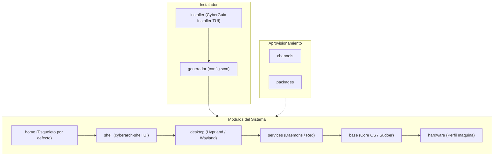

# Arquitectura del Sistema — CyberGuix Installer

Este documento constituye la **norma arquitectónica estática** del proyecto. Define los fundamentos de diseño, límites de responsabilidad y estructuras base del repositorio. Su propósito es actuar como contrato de referencia inmutable para desarrolladores y agentes de IA, permitiéndoles implementar cambios y extensiones con autonomía sin quebrar la coherencia del sistema.

---

## 1. Visión y Propósito

### 1.1 Naturaleza del proyecto
Este repositorio **no es una colección pasiva de dotfiles** ni un conjunto de configuraciones estáticas con datos hardcodeados. Es el **CyberGuix Installer**: un **software instalador interactivo (TUI) y generador de distribución** para GNU Guix, programado en Guile Scheme. Su responsabilidad es recolectar parámetros del usuario y la máquina, componer modularmente la definición del sistema operativo (`operating-system`), generar el archivo `config.scm` correspondiente y desplegarlo mediante `guix system init`.

### 1.2 Objetivo y Alcance
Proveer una experiencia de instalación guiada y moderna para GNU Guix que entregue un sistema operativo completamente funcional y listo para producción personal:
- **Generación declarativa a medida:** Las carpetas del proyecto (`base`, `desktop`, `home`, etc.) son **módulos de software parametrizables** (bibliotecas Guile Scheme) que el instalador ensambla para emitir un `config.scm` limpio y adaptado al hardware y usuario.
- **Modelo de usuario único con `sudo` (estilo Ubuntu):** Genera un único usuario administrador con privilegios `sudo` completos (grupo `wheel`), manteniendo la cuenta `root` deshabilitada por defecto.
- **Entorno predeterminado completo (Out-of-the-box):** Despliega una experiencia de escritorio pulida sobre Wayland con **cyberarch-shell**, proveyendo esqueletos y configuraciones por defecto sin guardar preferencias personales de ningún usuario en el repositorio.
- **Hardware modular:** Desacopla la lógica del sistema del hardware específico mediante perfiles de máquina (iniciando con el perfil para placa MS-7721).

### 1.3 Horizonte evolutivo
Nace para permitir al autor instalar y mantener Guix en su ordenador personal mediante un instalador TUI ergonómico, con la arquitectura modular necesaria para evolucionar hacia **CyberGuix: una distribución independiente basada en GNU Guix**.

---

## 2. Principios Rectores y Reglas de Diseño

Cualquier adición, refactorización o cambio en el código debe adherirse obligatoriamente a los siguientes principios:

### 2.1 El Instalador como Software y Scheme-First
- **Ingeniería de software en Scheme:** El instalador y sus componentes se programan exclusivamente en Guile Scheme. No se emplean scripts bash ni parches imperativos externos.
- **Guix como motor y runtime:** GNU Guix actúa como gestor de paquetes y motor de despliegue (`guix system init`). Nuestro software es el orquestador que construye dinámicamente la declaración del sistema.

### 2.2 Módulos Parametrizables (Cero Datos Hardcodeados)
- **Componentes como constructores:** Las capas (`base`, `hardware`, `services`, `desktop`, `shell`, `home`) actúan como módulos Guile que exportan procedimientos y registros configurables.
- **Cero datos estáticos rígidos:** UUIDs de disco, nombres de usuario, contraseñas o nombres de host nunca se graban a fuego en los módulos; se reciben como argumentos durante el proceso de instalación y ensamblaje.

### 2.3 Módulos Scheme Formales (Cero `load` frágiles)
- **Namespaces limpios:** Todo archivo `.scm` debe ser un módulo Guile formal declarado con `(define-module (...) #:use-module (...) #:export (...))`.
- **Prohibición de rutas relativas ciegas:** Queda prohibido el uso de `load` o `primitive-load` con rutas relativas. La importación se resuelve a través de `%load-path` y el sistema de módulos de Guile.

### 2.4 Generación Declarativa del Sistema Resultante
- **Generación de `config.scm` canónico:** El instalador TUI emite un archivo `config.scm` limpio, reproducible e independiente, guardado en el sistema destino (ej. `/etc/config.scm`), permitiendo al usuario final actualizar su máquina en el futuro mediante el estándar `guix system reconfigure`.

### 2.5 Responsabilidad Única y Modularidad (No God Files)
- **Un archivo, una responsabilidad:** Cada archivo encapsula un dominio concreto (un perfil de hardware, una receta de paquete local, un constructor de servicios, etc.).
- **Prohibición de God Files:** El instalador TUI delega la lógica de dominio en los módulos específicos y solo se encarga del flujo de interacción y ensamblaje.

### 2.6 Composabilidad Funcional
- **Constructores y procedimientos puros:** Los módulos ofrecen constructores funcionales (procedimientos que reciben parámetros y retornan registros o transformaciones de servicios). Cero variables globales mutables.

### 2.7 Screaming Architecture y Dependencias Unidireccionales
- **Estructura semántica:** La jerarquía de carpetas refleja directamente los subsistemas del instalador y del SO a construir.
- **Flujo Inward:** Las capas de mayor nivel consumen las inferiores. Se prohíben estrictamente las dependencias circulares.

### 2.8 Separación Estricta: Sistema vs. Esqueleto de Usuario
- **El Sistema (`operating-system`):** Define el hardware, daemons, seguridad y usuario con `sudo`.
- **El Esqueleto de Usuario (`home`):** Define la plantilla base de primer inicio (XDG dirs, temas, wallpapers, dotfiles base). No almacena datos personales ni configuraciones privadas.

### 2.9 Pragmatismo de Hardware y Aislamiento Non-Free
- **Compatibilidad pragmática:** Soporte para firmware privativo y kernels parcheados (Nonguix) para garantizar la operatividad de equipos reales.
- **Aislamiento estricto:** Las definiciones non-free se confinan en los módulos de hardware correspondientes sin alterar la pureza del resto de la arquitectura.

---

## 3. Modelo de Componentes y Capas

El sistema implementa una **arquitectura en capas con dependencias unidireccionales hacia adentro (Inward)**, orquestada por el instalador interactivo y aprovisionada por fuentes de paquetes.

### 3.1 Diagrama de Arquitectura



### 3.2 Catálogo y Responsabilidades de Módulos

| Componente | Módulo / Directorio | Responsabilidad Técnica | Dependencias |
|---|---|---|---|
| **CyberGuix Installer** | `installer/` | Interfaz interactiva de consola (TUI) que guía al usuario, captura parámetros (teclado, discos, usuario sudo, hardware) y ejecuta `guix system init`. | `channels/`, capas del sistema |
| **Canales** | `channels/` | Definición y fijación (*pinning*) de canales externos (Guix, Nonguix) con commits y firmas GPG. | Ninguna |
| **Paquetes** | `packages/` | Recetas locales en Scheme de paquetes ausentes o modificados respecto a los canales upstream. | `channels/` |
| **Hardware** | `hardware/` | Perfiles de máquina parametrizables (ej. `ms-7721.scm`). Proveen kernel, microcódigo, módulos del kernel y firmware non-free. | `channels/` |
| **Base** | `base/` | Constructores del núcleo del sistema: bootloader (GRUB/UEFI), particiones/filesystems, locales y creación de la cuenta administradora única con `sudo` (root deshabilitado). | `hardware/` |
| **Servicios** | `services/` | Constructores de servicios de infraestructura: login manager (`greetd`), red (`NetworkManager`), audio (`PipeWire`), asientos (`seatd`/`elogind`) y autorización (`polkit`). | `base/` |
| **Escritorio** | `desktop/` | Infraestructura gráfica: compositor Hyprland, portales XDG (`xdg-desktop-portal-hyprland`) y agente gráfico de elevación de privilegios (`polkit`). | `services/`, `base/` |
| **Shell** | `shell/` | Entorno visual de **cyberarch-shell**: orquestación de paneles, barra de estado, lanzador de aplicaciones, notificaciones y tema visual unificado. | `desktop/`, `services/`, `base/` |
| **Home (Esqueleto)** | `home/` | Plantilla base de primer inicio para el usuario: directorios XDG, dotfiles preconfigurados, fondos de pantalla y temas (sin datos privados). | `shell/`, `desktop/` |

---

## 4. Estructura del Repositorio (Screaming Architecture)

La jerarquía de directorios refleja directamente los dominios de software del instalador y del sistema:

```
[CyberGuix Root]/
├── installer/             # Software instalador interactivo TUI (CyberGuix Installer)
│   ├── tui/               # Pantallas de interacción (teclado, disco, usuario)
│   ├── generator.scm      # Ensamblador y serializador del config.scm final
│   └── runner.scm         # Ejecutor del comando guix system init
├── channels/              # Definiciones fijadas de canales externos
│   ├── guix.scm           # Pin de canal oficial GNU Guix
│   └── nonguix.scm        # Pin de canal Nonguix (firmware/kernel non-free)
├── packages/              # Recetas locales de paquetes Guix (un archivo por paquete)
├── hardware/              # Perfiles de hardware desacoplados
│   ├── common.scm         # Funciones comunes de detección/firmware
│   └── ms-7721.scm        # Perfil específico para placa base MS-7721
├── base/                  # Módulos del núcleo del sistema operativo
│   ├── boot.scm           # Configuración parametrizable de GRUB/EFI
│   ├── filesystem.scm     # Constructores de sistemas de archivos y swap
│   └── users.scm          # Constructor de usuario sudo único (root bloqueado)
├── services/              # Constructores de daemons y servicios del sistema
│   ├── desktop.scm        # D-Bus, Polkit, elogind/seatd
│   ├── audio.scm          # PipeWire y WirePlumber
│   └── networking.scm     # NetworkManager y resolución DNS
├── desktop/               # Capa gráfica base Wayland
│   ├── hyprland.scm       # Definición de paquetes y entorno para Hyprland
│   └── portals.scm        # Portales XDG y agentes polkit
├── shell/                 # Capa de experiencia CyberArch
│   ├── cyberarch.scm      # Orquestación de cyberarch-shell
│   └── assets/            # Fondos de pantalla, iconos y temas del sistema
├── home/                  # Esqueleto y plantilla por defecto de usuario
│   ├── skel/              # Dotfiles base para el primer inicio (~/.*)
│   └── xdg.scm            # Estructura de carpetas estándar (~/Descargas, etc.)
├── guix/                  # Claves públicas GPG de canales (ej. Nonguix)
├── scripts/               # Utilidades de desarrollo y testing del instalador
├── docs/                  # Documentación de usuario y guías de desarrollo
└── architecture.md        # Norma arquitectónica estática (este documento)
```

---

## 5. Modelo de Usuario y Generación de Entornos Home

### 5.1 Filosofía: Usuario Administrador Único sin Root Activo
Inspirado en el estándar de ergonomía y seguridad de distribuciones como Ubuntu:
- **Cuenta `root` bloqueada:** La cuenta de superusuario carece de contraseña interactiva habilitada en `/etc/shadow`, mitigando vectores de ataque directo.
- **Usuario administrador único:** El instalador crea una sola cuenta personal perteneciente al grupo administrativo (`wheel`).
- **Control total mediante `sudo`:** Toda elevación de privilegios se realiza mediante `sudo` utilizando la contraseña del propio usuario administrador.

### 5.2 El Rol del Módulo `home/`: Esqueleto por Defecto
El módulo `home/` no almacena dotfiles de un usuario particular:
1. **Estructura XDG limpia:** Define la creación automática de las carpetas estándar de usuario (`Documentos`, `Descargas`, `Imágenes`, etc.).
2. **Arranque funcional inmediato:** Provee dotfiles prefabricados en `/etc/skel` o perfiles Guix Home que vinculan la sesión gráfica directamente con `cyberarch-shell` y Hyprland.
3. **Identidad visual out-of-the-box:** Configura el fondo de pantalla por defecto, esquema de color y fuentes tipográficas del sistema.

### 5.3 Soberanía y Portabilidad del Usuario
Una vez desplegado el sistema, el usuario final goza de total libertad:
- Puede modificar cualquier archivo en su directorio `$HOME` sin riesgo de romper el sistema.
- Puede versionar sus propios dotfiles en un repositorio Git personal (ej. GitHub/GitLab) e instalarlos sobre el esqueleto provisto.

---

## 6. Flujo de Instalación y Ciclo de Vida

El ciclo de vida del sistema se divide en tres fases claras:

```
[Usuario ejecuta TUI]
         │
         ▼
 1. FASE INTERACTIVA
    - Idioma y teclado
    - Selección y particionamiento de disco
    - Detección / selección de hardware (ej. MS-7721)
    - Creación de usuario administrador (nombre y contraseña sudo)
         │
         ▼
 2. FASE DE GENERACIÓN Y ENSAMBLAJE
    - Invoca constructores de `hardware`, `base`, `services`, `desktop`, `shell`, `home`
    - Inyecta UUIDs de disco y parámetros del usuario
    - Emite el archivo declarativo final `/mnt/etc/config.scm`
         │
         ▼
 3. FASE DE DESPLIEGUE (BOOTSTRAP)
    - Ejecuta: `guix system init /mnt/etc/config.scm /mnt`
    - Descarga/construye el store en el disco destino
    - Instala bootloader e inicializa skeletons en `$HOME`
         │
         ▼
[Reinicio en el Sistema Instalado]
         │
         ▼
 4. CICLO DE VIDA POST-INSTALACIÓN
    - Actualizaciones declarativas estándar:
      `guix pull`
      `guix system reconfigure /etc/config.scm`
```

---

## 7. Reglas Inmutables para Agentes de IA y Contribuidores

Cualquier agente de IA o desarrollador que modifique este repositorio debe cumplir estrictamente las siguientes reglas:

1. **Nunca hardcodear credenciales, rutas fijas o UUIDs:**
   Todo código en `base/`, `hardware/`, `desktop/` o `services/` debe ser un procedimiento o registro parametrizable que reciba datos de configuración como argumentos.
2. **Respetar el sistema de módulos de Scheme:**
   - Todo archivo `.scm` debe comenzar con `(define-module (...) ...)`.
   - Está prohibido el uso de `(load ...)` o `(primitive-load ...)` con rutas relativas entre módulos.
3. **Mantener la pureza de capas (Inward Only):**
   Un módulo de `base/` o `hardware/` jamás debe importar ni depender de `desktop/`, `shell/` o `installer/`.
4. **No introducir scripts imperativos externos:**
   Toda la lógica de preparación, configuración y generación debe implementarse en Guile Scheme dentro del instalador o de los módulos del sistema.
5. **No almacenar datos de usuario particulares:**
   `home/` solo debe contener plantillas genéricas, assets visuales del sistema y skeletons reproducibles.

---

## 8. Roadmap de Evolución hacia la Distribución

- **Fase 1 (Actual):** Módulos parametrizables en Guile Scheme, perfil de hardware para placa MS-7721, integración de Hyprland con `cyberarch-shell` y esqueleto base de usuario.
- **Fase 2:** Implementación del instalador interactivo TUI minimalista y su generador de `config.scm`.
- **Fase 3:** Detección automática de hardware y abstracción de perfiles adicionales.
- **Fase 4:** Construcción de una imagen ISO instalable autocontenida que arranque directamente en el CyberGuix Installer.
